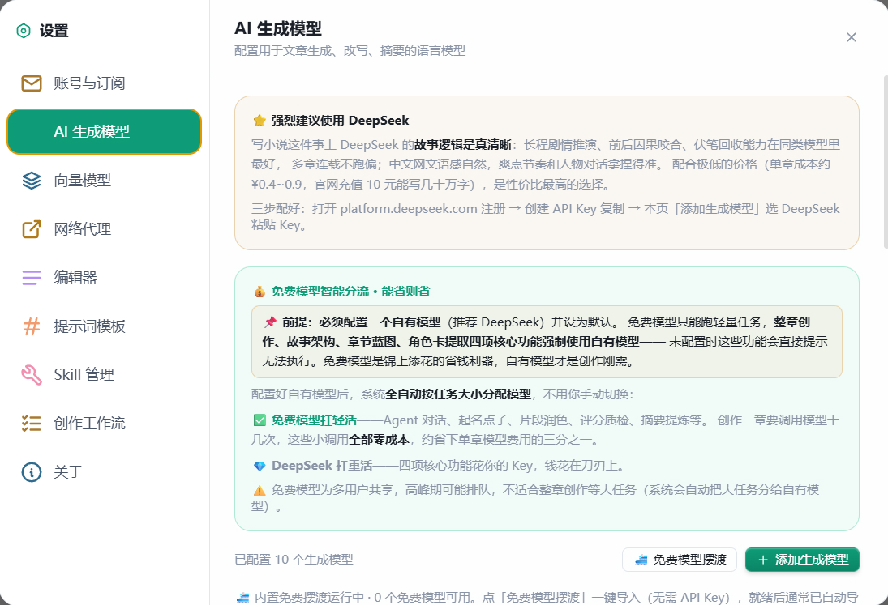
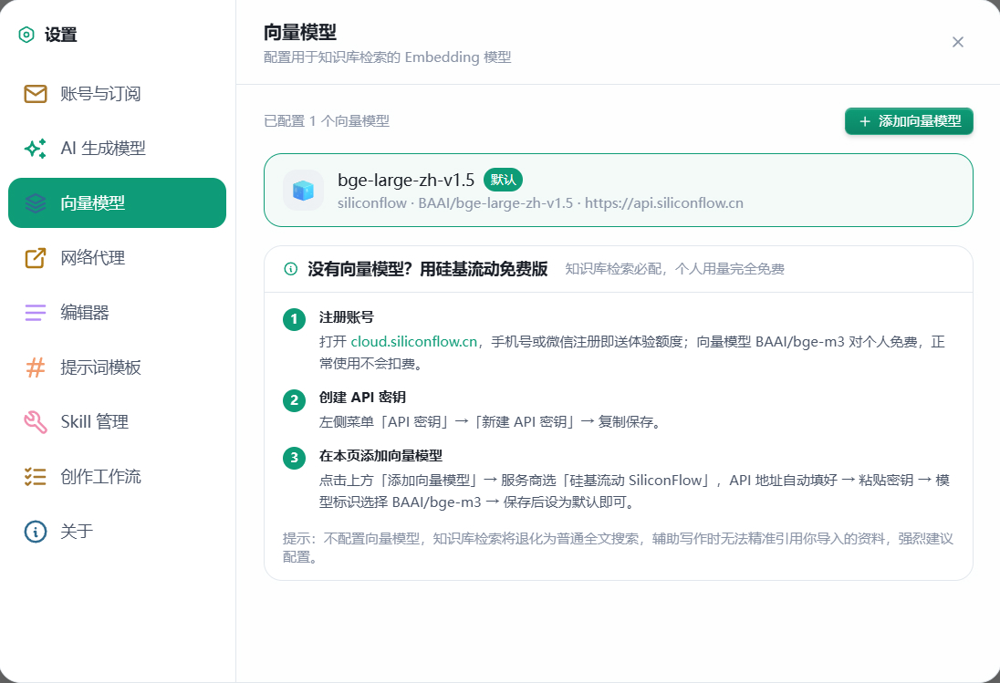
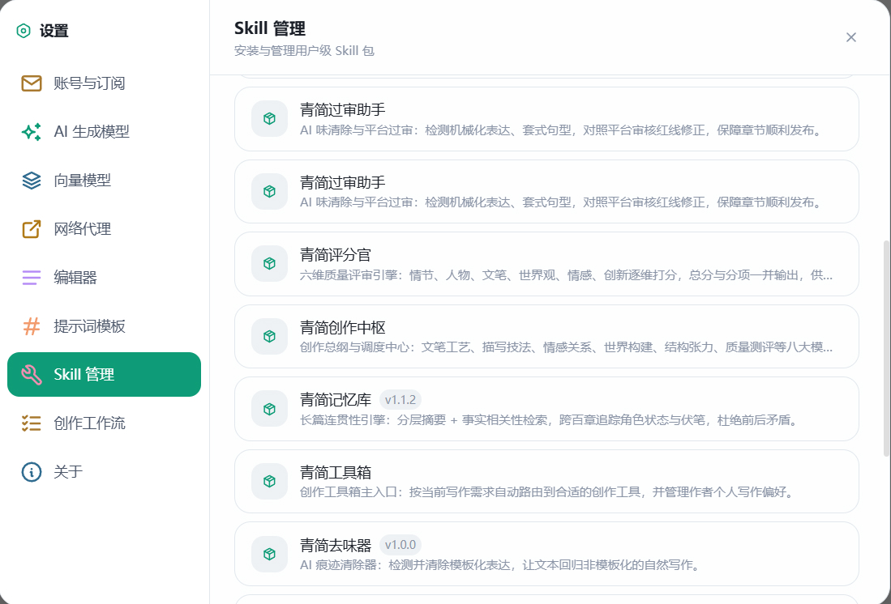
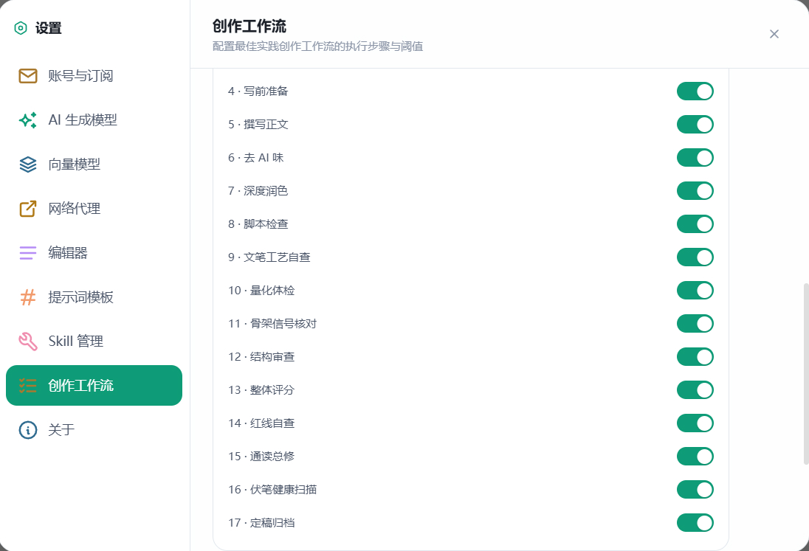

# 小说创作辅助工具
# 青简 - 网文AI写作辅助工具#
# 网文写作#, # AI写作#, # 小说辅助工具#, # 码字软件#, # AIGC#, # 网文生成器#, # 写作助手#, # 大语言模型#, # Windows客户端#, # 作家工具#
# 防剧情漂移#, # 本地知识库#, # LanceDB#, # AI提示词#, # 自动修复#, # 工作流#，#小说创作#，#创作助手#，#AI小说#，#AI创作#
青简是什么
青简是面向网文创作者的 AI 写作辅助工具（Windows 客户端 v1.2.1），核心功能包含 17 步全流程创作工作流、本地 LanceDB 知识库、质检自动修复闭环、SKILL 技能系统、八层防剧情漂移体系， 以及今天刚上线的 快捷站点面板：客户端内弹窗直达 AI 工具与发布平台，提示词按当前小说自动生成。
核心差异：100% 本地数据不上传、自带 Key 零抽成（单章 AI 成本约 0.4~0.9 元）、知识库永久免费、本地红线确定性扫描。 展示作品《道种》全部由青简 17 步工作流生成定稿；免费版支持前 5 步创作流程体验，先试再用。
网文AI写作辅助工具 | 青简 v1.2.1 (Windows)
面向网文创作者的 AI 码字神器。核心功能：17步全流程创作、本地 LanceDB 知识库、质检自动修复、八层防剧情漂移体系。
🎉最新上线：快捷站点面板！客户端内弹窗直达 AI 工具与发布平台，提示词按当前小说自动生成。让 AI 真正懂你的小说！
下载地址：https://www.woxueit.vip:88/

如果需要合作，请联系
